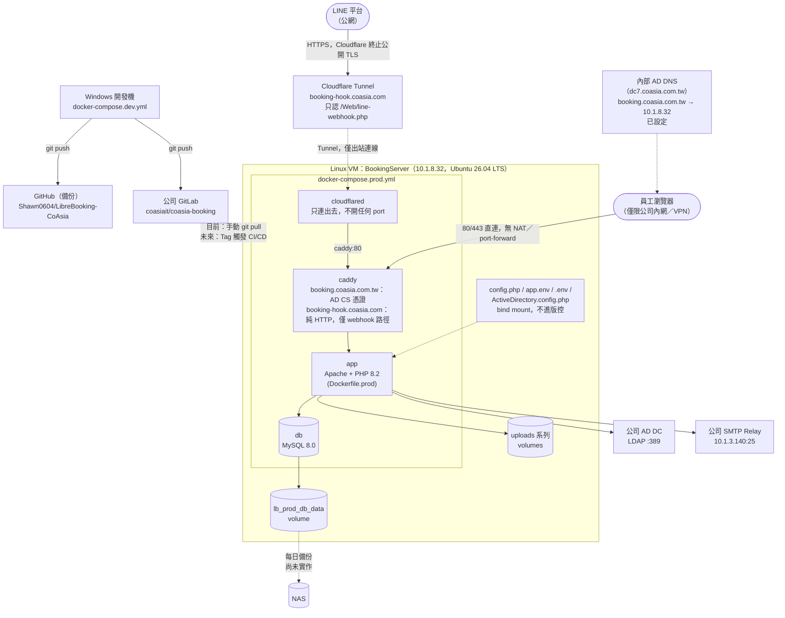

# CoAsia Booking 正式環境部署指南

這份文件記錄「把 CoAsia Booking 從 Windows 開發環境，部署到公司內網正式環境」的架構、操作步驟，以及過程中踩過的坑。跟 `COASIA-GOLIVE-CHECKLIST.md`（上線前還缺什麼業務/資安面的事）不同，這份是**部署架構本身怎麼設計、怎麼操作、出過什麼問題**的技術參考文件；跟 `COASIA-CHANGES.md`（記錄應用程式改了什麼、為什麼）也不同，這份專注在部署/基礎設施這一層。

最後更新：2026-08-07

---

## 目前進度

- ✅ 程式碼已推上公司 GitLab（`coasiait/coasia-booking`），同時保留推上個人 GitHub（`Shawn0604/LibreBooking-CoAsia`）當備份，兩邊維持同步
- ✅ Linux VM 已建立：`BookingServer`（Ubuntu 26.04 LTS），固定 IP `10.1.8.32`
- ✅ VM 到 GitLab（22/443）、SMTP relay（10.1.3.140:25）、AD LDAP（10.1.3.125:389）連線都測試成功
- ✅ Docker 29.7.1 + Docker Compose v5.4.0 已安裝
- ✅ `Dockerfile.prod`、`docker-compose.prod.yml`、`Caddyfile`、`.env.prod.example`、`.dockerignore` 已寫好並推上兩邊 repo
- ✅ 第一次在 VM 上 build／up 成功，`app`／`db`／`caddy` 三個服務都正常
- ✅ 資料庫已從測試環境搬過來（`mysqldump` → `mysql` 還原，schema version 4.2）
- ✅ 踩到並修好一個環境變數蓋掉 `config.php` 的坑（見「部署時踩到的坑」），修好後 `curl http://localhost/Web/` 回 `200 OK`
- ✅ 確定走**內網限定**方案，不對外公開（見「TLS／DNS 決策」）
- ✅ 內部 DNS 已設定：`booking.coasia.com.tw → 10.1.8.32`（加在 `dc7.coasia.com.tw` 的 `coasia.com.tw` 區域）
- ✅ 確認公司有架 **AD CS**（`coasia-CSSRV-CA`，在 `DC6.coasia.com.tw`，有 Web 註冊介面），已申請正式憑證換掉自簽版，瀏覽器完全不再跳警告
- ✅ 用瀏覽器實際打開過 `https://booking.coasia.com.tw`，登入頁正常顯示，AD 帳密登入、管理中心角色切換都驗證過
- ✅ LINE Webhook 對外公開問題已解決：加了一條範圍限定的 Cloudflare Tunnel，只讓 `/Web/line-webhook.php` 這條路徑能被外部連到，主體 app 依然內網限定不受影響（見「十四、LINE Webhook 對外公開」）
- ⬜ 還沒清掉測試預約資料（`COASIA-GOLIVE-CHECKLIST.md` 提到的 57 筆）
- ⬜ LINE Developers 後台的 Webhook URL 還沒正式改成新網址，還沒找真人重新測過綁定
- ⬜ NAS 備份協定、GitLab Runner 部署方式仍待決定（見「尚待確認的決策」）
- ⬜ 還沒有自動化的 CI/CD pipeline，目前全部是手動在 VM 上跑指令
- ⬜ 「使用者管理」編輯頁面沒有併發衝突偵測，兩個管理員同時編輯同一個使用者會靜默互相覆蓋（只在應用程式層級發現，跟部署無關，記在這裡提醒）

---

## 目標架構

正式網址：`https://booking.coasia.com.tw`——**內網限定**，不對外公開（見「TLS／DNS 決策」）。唯一對外公開的例外是 LINE Webhook，走範圍限定的 Cloudflare Tunnel（見「十四」）。虛線代表還沒接上／規劃中的部分。



---

## 一、建立 Linux VM（ESXi）

在 ESXi Host Client（`https://10.1.3.124`，也可能是叢集裡其他台主機的 Host Client）用「新增虛擬機器」精靈建立，選擇「建立新的虛擬機器」。

### 名稱與客體作業系統
- 名稱：`BookingServer`
- 相容性：`ESXi 7.0 U2 虛擬機器`（精靈預設反白選取的最高版本，不用改）
- 客體作業系統系列：`Linux`
- 客體作業系統版本：`Ubuntu Linux (64位元)`

### 儲存區
選有空間的資料存放區即可（實際用的是 `CETP-SVR-NAS03`，NAS 儲存區，不是本機硬碟——效能沒問題，且對備份/快照更方便）。

### 自訂設定
- CPU：2 顆
- 記憶體：8 GB
- 硬碟 1：100 GB，**精簡佈建（Thin Provision）**（不要選厚佈建，避免一次佔滿空間）
- SCSI 控制器 0：`VMware Paravirtual`（預設值，效能較好，保留）
- USB 控制器：可留可不留，無頭伺服器用不到
- **網路介面卡 1：要改成 `VM Network1`**（不是預設的 `VM Network`！這是公司內部服務用的網段，其他 `*.coasia.com.tw` 主機都在這個網段，選錯會連不到 GitLab／DC／SMTP relay）
- CD/DVD 光碟機：先不連（沒有安裝 ISO 前這步會卡住），等 ISO 準備好再回來編輯設定掛上去

### 安裝媒介
下載 Ubuntu Server 最新 LTS 的 ISO（實際用的是 `ubuntu-26.04-live-server-amd64.iso`），上傳到某個資料存放區（例如 `VM124_datastore1`），回到 VM 的「編輯設定」，把 CD/DVD 光碟機改成「資料存放區 ISO 檔案」指過去，勾選「連線」和「開啟電源時連線」，存檔後開機。

---

## 二、安裝 Ubuntu Server

用 Subiquity 安裝精靈，各步驟的選擇：

| 步驟 | 選擇 | 備註 |
| --- | --- | --- |
| Keyboard configuration | 保持 `English (US)` | 伺服器主要靠 SSH 操作，鍵盤配置不重要 |
| Choose the type of installation | `Ubuntu Server`（不要選 minimized） | minimized 版本是給不需要人登入維護的自動化環境用的 |
| Network configuration | 先保持 DHCP，裝完後再處理固定 IP | 見下方「三、網路設定」 |
| Proxy configuration | 留空 | 公司內網可以直接連外部 apt mirror，不需要 proxy |
| Ubuntu archive mirror | 保持預設，測試會通過 | 會自動抓到 `tw.archive.ubuntu.com` |
| Guided storage configuration | `Use an entire disk`，勾選 `Set up this disk as an LVM group`，**不要**勾 `Encrypt the LVM group with LUKS` | LUKS 加密會導致每次重開機都要手動輸入密碼解鎖，跑 Docker 服務的伺服器不能這樣 |
| Storage configuration（分割摘要） | **手動把 `/` 的大小從精靈預設的一半左右，改成整顆 LVM 的全部空間** | 精靈預設只會分約一半給 `/`，其餘留白浪費掉；點 `USED DEVICES` 底下的 `ubuntu-lv` 那行 → Edit → 把 Size 清空/設到最大 |
| Confirm destructive action | Continue | 全新磁碟，沒有東西可以丟失 |
| Profile setup | 帳號自己決定（實際用 `shawn_admin`），hostname 用 `bookingsvr` 這類小寫簡短名稱，密碼自己設定 | |
| Upgrade to Ubuntu Pro | `Skip for now` | 用不到，付費服務 |
| SSH Setup | **務必勾選 `Install OpenSSH server`**（精靈預設不勾！），`Allow password authentication over SSH` 先保持勾選 | 沒裝 SSH server 的話裝完只能用 ESXi 主控台操作，非常不方便 |
| Featured Server Snaps | 全部不勾 | 沒有 Docker，Docker 要另外用官方 apt repo 裝，不要用 snap 版本 |

裝完 `Reboot Now` 前，記得回 ESXi 把 CD/DVD 光碟機的「連線」跟「開啟電源時連線」都取消勾選，不然重開機可能又跑去讀安裝光碟。

---

## 三、網路設定：固定 IP

Ubuntu 裝完後 DHCP 給的 IP **不保證每次都一樣**（實測從安裝時的 `10.1.8.18` 變成重開機後的 `10.1.8.32`），必須固定下來。

做法：**在 DHCP 伺服器上設「保留位址」**，不用改 Ubuntu 端任何設定：

1. 先用 `ip a` 查這台的網卡 MAC 位址（`ens192`）
2. 登入 DHCP 伺服器（`dc7.coasia.com.tw`）的「DHCP」管理主控台
3. 找到 `[10.1.0.0]` 這個 Scope 底下的「位址租用」，找到這台目前拿到的 IP（對應到 hostname `bookingserver`）
4. 右鍵該筆租用 → 「新增至保留」，把 MAC 位址跟 IP 綁定
5. 之後在「保留區」節點可以看到 `[10.1.8.32] bookingserver.coasia.com.tw` 這筆

這個 Scope 裡其實混了不少既有伺服器（`zabbix`、`veeam11`、`samba` 等），不是純粹的員工電腦專用 scope，所以跟其他伺服器共用沒問題。

---

## 四、安裝 Docker

用 Docker 官方 apt repo（不是 Ubuntu 內建的舊版 docker.io，也不是 snap 版）：

```bash
sudo apt update && sudo apt upgrade -y

sudo apt remove -y docker docker-engine docker.io containerd runc 2>/dev/null

sudo apt install -y ca-certificates curl gnupg

sudo install -m 0755 -d /etc/apt/keyrings
curl -fsSL https://download.docker.com/linux/ubuntu/gpg | sudo gpg --dearmor -o /etc/apt/keyrings/docker.gpg
sudo chmod a+r /etc/apt/keyrings/docker.gpg

echo "deb [arch=$(dpkg --print-architecture) signed-by=/etc/apt/keyrings/docker.gpg] https://download.docker.com/linux/ubuntu $(. /etc/os-release && echo "$VERSION_CODENAME") stable" | sudo tee /etc/apt/sources.list.d/docker.list > /dev/null

sudo apt update
sudo apt install -y docker-ce docker-ce-cli containerd.io docker-buildx-plugin docker-compose-plugin

sudo usermod -aG docker $USER
```

**跑完 `usermod` 之後，`docker --version` 這種不碰 `docker.sock` 的指令會「看起來」沒事，但 `docker compose build`／`up` 這種真的要操作 Docker daemon 的指令會 `permission denied`**——因為 group 權限要新的登入 session 才會生效。解法：跑 `newgrp docker`（讓目前這個 shell 立即套用新群組），或直接登出重連 SSH。

驗證：`docker --version`（實測 `29.7.1`）、`docker compose version`（實測 `v5.4.0`）。

---

## 五、GitLab：專案與 Deploy Key

### 建立專案
在公司 GitLab（`https://10.1.3.148`）的 `CoasiaIT` 群組下建立空白專案：
- Project name：`Coasia Booking`（URL slug 自動變成 `coasia-booking`）
- 可見性：**私有**
- **不要**勾選「初始化儲存庫時自動建立 README 檔」——本地已經有一堆 commit 歷史要推上去，先建空的 repo，不然兩邊歷史對不起來，push 會被拒絕

### 在 VM 上建立專用的 Deploy Key（不是個人帳號的 key）

```bash
ssh-keygen -t ed25519 -C "bookingserver-deploy" -f ~/.ssh/id_ed25519_deploy -N ""
cat ~/.ssh/id_ed25519_deploy.pub
```

到 GitLab 專案的 Settings → Repository → Deploy Keys → 新增密鑰，貼上公鑰，**不要勾選「Grant write permissions」**——這台只需要讀取拉程式碼，用最小權限的 Deploy Key 比加到個人帳號的 SSH key 更安全（就算這把 key 被盜用，也只能讀這一個 repo）。

VM 上設定 SSH config 讓連 GitLab 時用這把 key：

```bash
cat >> ~/.ssh/config <<'EOF'

Host 10.1.3.148
    HostName 10.1.3.148
    User git
    IdentityFile ~/.ssh/id_ed25519_deploy
    StrictHostKeyChecking accept-new
EOF
```

### Clone

```bash
git clone git@10.1.3.148:coasiait/coasia-booking.git ~/coasia-booking
cd ~/coasia-booking
git checkout develop
```

---

## 六、機密檔案設定

`config/config.php`、`.env`、`app.env`、`plugins/Authentication/ActiveDirectory/ActiveDirectory.config.php`、`uploads/`、`var/`、`tpl_c/` 本來就在 `.gitignore` 裡，不會進 GitLab／GitHub——這代表 VM 上要維護幾份**不經過版控**的實體檔案，部署時用 bind mount 掛進 `app` 容器，不是靠 `git pull` 帶過去。

### 兩個不同的 `.env`，注意不要搞混

| 檔案 | 誰讀的 | 內容 | 範本 |
| --- | --- | --- | --- |
| `.env`（跟 `docker-compose.prod.yml` 同一層） | `docker compose` 自己 | 只放 `MYSQL_*` 這幾個 compose 層級變數 | [.env.prod.example](.env.prod.example) |
| `app.env` | 掛進容器變成 `/var/www/html/.env`，給 PHP 的 Dotenv 讀 | app 自己的 `LB_` 前綴設定 | [.env.example](.env.example) |

### 傳檔案到 VM

`config/config.php` 跟 `ActiveDirectory.config.php` 這兩個 Windows 開發機上已經有測試過可以動的版本（LDAP、SMTP 設定都驗證過），直接用 `scp` 從 Windows 的 PowerShell 傳過去（會問 VM 的登入密碼）：

```powershell
scp "D:\Coding\LibreBooking-CoAsia\config\config.php" shawn_admin@10.1.8.32:~/coasia-booking/config/config.php
scp "D:\Coding\LibreBooking-CoAsia\plugins\Authentication\ActiveDirectory\ActiveDirectory.config.php" shawn_admin@10.1.8.32:~/coasia-booking/plugins/Authentication/ActiveDirectory/ActiveDirectory.config.php
```

`config.php` 傳過去後要改資料庫那段（開發環境用的是 `127.0.0.1:3307` 直連，正式環境要指到 compose 裡的 `db` 服務名稱）：

```php
'database' => [
    'type' => 'mysql',       // 注意不是 'db'，這個欄位是資料庫種類
    'hostspec' => 'db',      // compose 服務名稱，不是 IP
    'name' => 'librebooking',
    'user' => 'lb_user',
    'password' => '<跟 .env 的 MYSQL_PASSWORD 一致>',
],
```

### 建立 `.env` 跟 `app.env`

```bash
cd ~/coasia-booking
cp .env.example app.env
cp .env.prod.example .env

# 產生兩組新密碼（不要沿用開發環境的密碼）
openssl rand -base64 24   # 給 MYSQL_PASSWORD，同時要填進 config.php 的 database.password
openssl rand -base64 24   # 給 MYSQL_ROOT_PASSWORD
```

編輯 `.env`，填入 `MYSQL_DATABASE=librebooking`、`MYSQL_USER=lb_user`、剛剛兩組密碼。編輯 `app.env`，把 `LB_SCRIPT_URL` 改成 `https://booking.coasia.com.tw`、確認 `LB_APP_DEBUG=false`。

### ⚠️ 部署時踩到的坑：`app.env` 蓋掉 `config.php` 的資料庫設定

**症狀**：`config/config.php` 設定完全正確、`composer preflight` 檢查資料庫連線也顯示 `[PASS] Database connection: connected`，但一從瀏覽器/curl 打真正的網頁，就會 500，錯誤是：

```
DatabaseConnectionException: Error connecting to database
Error: Connection refused in /var/www/html/lib/Database/MySQL/MySqlConnection.php:48
```

**排查過程中最誤導人的地方**：不管用 `docker compose exec app php -r '...'` 怎麼手動測試 `mysqli_connect()`（甚至用 `--user www-data` 模擬 Apache worker 的身份、甚至精確重現 app 用的那個函式呼叫方式），連線都**完全正常**，唯獨真正透過 Apache 處理的請求會失敗。連重啟容器、重新 build image 都沒用。

**根本原因**：`lib/Config/Configuration.php` 的 `GetKey()` 邏輯是「只要對應的 `LB_*` 環境變數有值，就優先蓋掉 `config.php` 的設定」（`ConfigKeysMeta::envKeyForConfig()` 把 `database.hostspec` 這種 key 轉成 `LB_DATABASE_HOSTSPEC` 這種環境變數名稱去查）。而 `.env.example`（`app.env` 的複製來源）裡剛好有這幾行非空的預設值：

```
LB_DATABASE_HOSTSPEC='127.0.0.1'
LB_DATABASE_USER='lb_user'
LB_DATABASE_PASSWORD='password'
LB_DATABASE_NAME='librebooking'
LB_PHPMAILER_SMTP_AUTOTLS=true
LB_PHPMAILER_SMTP_AUTH=true
```

這些值會直接蓋掉 `config.php` 裡已經測試驗證過的正確設定。`hostspec` 被蓋成 `127.0.0.1` 之後，app 容器裡的 `127.0.0.1` 根本沒有 MySQL 在監聽（MySQL 在另一個叫 `db` 的容器裡），所以才會 `Connection refused`。而我手動用 `php -r` 測試時是直接 `include config.php` 讀原始陣列自己連線，完全繞過 `Configuration::GetKey()` 這層覆蓋邏輯，才會怎麼測都正常——這就是為什麼排查花了很久：**看起來「連線本身沒問題」的證據，其實從來沒有真正走過 app 實際會用的程式碼路徑**。

`LB_PHPMAILER_SMTP_AUTOTLS`／`LB_PHPMAILER_SMTP_AUTH` 這兩個當下還沒發作（因為還沒人觸發寄信），但原理一樣，會在第一次寄信時炸掉（公司內部 SMTP relay 是不需要帳密/TLS 的 open relay，被蓋成 `true` 之後會連線失敗）。

**修法**：`app.env` 從 `.env.example` 複製過來後，一定要先跑這兩行，把會跟 `config.php` 打架的欄位刪掉：

```bash
sed -i '/^LB_DATABASE_/d' app.env
sed -i '/^LB_PHPMAILER_/d' app.env
```

再確認一次沒有殘留：`grep -E "DATABASE|PHPMAILER" app.env` 應該要沒有任何輸出。

**通用排查心法**（這次學到的）：如果「手動用 CLI 測試都正常，但實際網頁請求就是不行」，先懷疑是不是有**兩條不同的程式碼路徑**在做同一件事——這次的情況是「直接 `include` 讀檔案」vs「透過 `Configuration::GetKey()` 讀取（會被環境變數覆蓋）」，兩條路徑表面上應該要讀到一樣的值，但其實不是。

---

## 七、資料庫遷移（把測試環境資料搬過來，而不是全新安裝）

考慮到測試環境已經做了不少設定（AD 打通、112 位員工帳號匯入、LINE 通知綁定測試過），選擇把整個資料庫搬過來，而不是走 `Web/install/` 從零開始。

### 在 Windows（開發機）dump

```bash
docker compose -f docker-compose.dev.yml exec db mysqldump -uroot -plibrebooking_root_password --single-transaction --routines --triggers librebooking > librebooking_dump.sql
```

### 傳到 VM（PowerShell scp，同上面傳 config.php 的方式）

```powershell
scp "D:\Coding\LibreBooking-CoAsia\librebooking_dump.sql" shawn_admin@10.1.8.32:~/coasia-booking/librebooking_dump.sql
```

### 在 VM 上還原進正式環境的 `db` 容器

```bash
docker compose -f docker-compose.prod.yml exec -T db mysql -uroot -p'<MYSQL_ROOT_PASSWORD>' librebooking < librebooking_dump.sql
```

還原後用 `composer preflight` 確認 `schema version` 有出現（實測 `4.2`），代表資料表都進去了。

**注意**：搬過來的資料庫裡還有 golive checklist 提到的 57 筆測試預約（空白標題、"test"、"tt" 那些），正式開放前要記得清掉，這份文件沒有處理這件事。

---

## 八、Build 與啟動

```bash
cd ~/coasia-booking
docker compose -f docker-compose.prod.yml build
docker compose -f docker-compose.prod.yml up -d
docker compose -f docker-compose.prod.yml ps
```

第一次 build 時踩到一個小問題：`Dockerfile.prod` 的 `mkdir -p` 漏了 `var`（`var/` 因為在 `.dockerignore` 裡被排除，不會隨 `COPY . .` 帶進 image，所以要額外 `mkdir`），導致後面的 `chown -R www-data:www-data ... var` 因為目錄不存在而失敗（`No such file or directory`）。已經在 `Dockerfile.prod` 裡修好（`mkdir -p` 那行加上 `var`）。

---

## 九、驗證方式

### 1. `composer preflight`（檢查 PHP 環境、擴充套件、設定檔、寫入權限、資料庫連線）

```bash
docker compose -f docker-compose.prod.yml exec app composer preflight -- --no-color
```

### 2. 從容器內部直接 curl（繞過 Caddy／HTTPS，先確認 app 本身沒問題）

```bash
docker compose -f docker-compose.prod.yml exec app curl -sI http://localhost/Web/
```

### 3. 排查真正的網頁請求問題時，直接放一個臨時診斷檔案

當 CLI 測試都正常但網頁請求失敗時（就是上面第六節那個坑的排查過程），最有效的方法是直接在 `Web/` 底下放一個臨時 `.php` 檔案，透過 Apache 實際執行、印出 `getcwd()`、設定值、連線結果，測完馬上刪掉。這比在容器裡用 `docker compose exec` 跑 CLI 腳本更準，因為能重現「真正走過 Apache SAPI」的那條路徑。

### 4. 用瀏覽器實際看畫面（DNS／TLS 還沒設定好之前的臨時做法）

因為 `Caddyfile` 目前只認 `booking.coasia.com.tw` 這個網域名稱，直接用 IP 打會被 Caddy 擋掉（比對不到任何規則），`app` 容器本身也沒有對外開 port（只有 `caddy` 有發布 80/443）。臨時測試方法：用一個 `alpine/socat` 容器接到 `app` 容器的 80 port，另外開一個測試用的對外 port：

```bash
docker run --rm -d --name temp-test-proxy --network coasia-booking_default -p 8081:80 alpine/socat tcp-listen:80,fork,reuseaddr tcp-connect:coasia-booking-app-1:80
```

然後在 Windows 瀏覽器打開 `http://10.1.8.32:8081/Web/`。**測完務必清掉**：

```bash
docker stop temp-test-proxy
```

正式的做法應該是等 DNS／TLS 決定好之後，透過 Caddy 用真正的網域名稱測試，這個 socat 方法只是過渡期的權宜之計。

---

## 十、Volumes 規劃

| Volume | 掛載到 | 需要持久化？ |
| --- | --- | --- |
| `lb_prod_db_data` | `/var/lib/mysql` | 需要，備份重點 |
| `lb_prod_uploads` | `uploads/` | 需要 |
| `lb_prod_uploads_images` | `Web/uploads/images` | 需要 |
| `lb_prod_uploads_tos` | `Web/uploads/tos` | 需要 |
| `caddy_data` / `caddy_config` | Caddy 內部狀態 | 需要，保留 Caddy 自己的執行狀態 |
| `config/config.php`、`.env`、`app.env`、`ActiveDirectory.config.php`、`certs/`（AD CS 憑證＋私鑰） | 機密檔案／憑證 | 用 bind mount，不是 named volume，見「六」「十三」 |
| `tpl_c/` | Smarty 編譯快取 | **不需要**，每次部署重建即可，持久化反而可能讓部署後還吃到舊快取 |

---

## 十一、（規劃中）完整部署流程

目前只做到手動在 VM 上跑指令，還沒有 CI/CD。未來規劃的流程，對應「本機測試 → push GitLab → 建立 Tag → Linux 取得版本 → 備份資料庫 → 重建 App → 健康檢查」：

1. **本機測試**：現行 `docker-compose.dev.yml` + `composer phpunit`／`phpstan`，不變
2. **push GitLab**：觸發 CI（lint、phpunit，可沿用現有 `.github/workflows` 的邏輯搬到 `.gitlab-ci.yml`）
3. **建立 Tag**：觸發 build job，`docker build -f Dockerfile.prod` → push 到 GitLab Container Registry（版本號 tag + `stable` 別名）
4. **Linux 取得版本**：建議把 GitLab Runner 直接註冊在 `BookingServer` 這台 VM 上（shell executor），deploy stage 就在 VM 本機執行，不用額外管理 SSH deploy key
5. **備份資料庫**：deploy 腳本第一步先 `docker exec db mysqldump`，存到本機（檔名帶時間戳＋即將部署的 tag 版本號），成功才繼續
6. **重建 App**：`docker compose pull/build` 新 image → `up -d app`；`db` 服務不動，volume 不受影響
7. **健康檢查**：`docker exec app composer preflight -- --no-color --skip-db` + `docker compose ps` 確認 healthy
8. **失敗可回上一個 Tag**：VM 上保留最近幾個 image tag，失敗時用上一個 tag 重啟 `app` 容器即可回退——但**這只回退程式碼，不回退資料庫結構**。若該次 tag 含 schema 變更（目前透過 `Web/install/` 或 `database_schema/` 手動執行，沒有自動 migration 工具），回退程式碼後可能跟資料庫結構對不上，需要靠步驟 5 的備份還原，而不是單純切 tag。

---

## 十二、每日備份（規劃中，尚未實作）

`mysqldump` 全庫 + `uploads/` 打包，排程跑在 VM（cron 或獨立小 container），推到 NAS（協定待確認）。建議保留至少 14–30 天 rolling，上線前務必實際跑一次還原演練。

---

## 十三、TLS／DNS 決策：內網限定，不對外公開

**已決定**：`booking.coasia.com.tw` 只給公司內網／VPN 內的使用者連，不開放公網存取。理由：這是深度綁定 AD 的內部工具（員工訂公司會議室），使用情境本來就是內部員工，不對外公開可以省掉整套公網暴露相關的麻煩（NAT/port-forward、公開攻擊面、憑證續期依賴外部服務）。

### 過程中考慮過、後來放棄的做法

一度想接 **Cloudflare Tunnel**（公司剛好在 Cloudflare 上管理 `coasia.com` 這個公開網域，`cloudflared` 也是先前測 LINE webhook 用過的熟悉工具），好處是完全不用開任何對外 port、憑證由 Cloudflare 自動處理。但實際去 Cloudflare 後台设定時發現：

1. 要用的網址其實該是 `booking.coasia.com`（`.com`，不是 `.com.tw`）——公司在 Cloudflare 上只有 `coasia.com` 這個公開區域
2. 要啟用 Tunnel 得先進 **Zero Trust**，而 Zero Trust 首次啟用會要求輸入信用卡（就算是免費額度也要留卡）
3. 更根本的問題：這整套是為了「讓外部網路連得到」而設計的，但這個系統的使用情境本來就是內部員工——沒有对外開放的實際需求，等於是為了不存在的需求繞了一大圈

同事之前架的 `app.coasia.com`（Cloudflare Proxy／橘色雲朵模式）也考慮過，但那個做法需要公司防火牆把某個公網 IP 的 port-forward 到這台 VM，一樣是「先製造出對外暴露的需求，再解決它」，跟內網限定的方向相反，所以也放棄了。

### 目前設定（已完成）

- **內部 DNS**：在 `dc7.coasia.com.tw` 的 DNS 管理員 → `coasia.com.tw` 正向對應區域 → 新增主機 (A)：`booking` → `10.1.8.32`
- **憑證**：公司確實有架 **AD CS**，透過 `certutil -ADCA`／`certutil -config - -ping` 查出三個可用的 CA（`CA`@`filesvr.coasia.com.tw`、`coasia-CSSRV-CA`@`DC6.coasia.com.tw`、`coasia-DC1-CA`@`DC1.coasia.com.tw`），`DC6` 這台有裝 Web 註冊介面（`http://DC6.coasia.com.tw/certsrv`）。實際申請流程：
  1. 在 VM 上用 openssl 產生 CSR：
     ```bash
     mkdir -p ~/coasia-booking/certs
     cd ~/coasia-booking/certs
     openssl req -new -newkey rsa:2048 -nodes \
       -keyout booking.key \
       -out booking.csr \
       -subj "/CN=booking.coasia.com.tw" \
       -addext "subjectAltName=DNS:booking.coasia.com.tw"
     cat booking.csr
     ```
  2. 瀏覽器開 `http://DC6.coasia.com.tw/certsrv` → 用網域帳密登入 → 「申請憑證」→「進階憑證申請」→「提交憑證要求或更新要求」
  3. 把 CSR 內容貼進「已儲存的要求」文字框，「憑證範本」選 **Web 伺服器**（預設是「使用者」，一定要換），「屬性」欄位補一行 `san:dns=booking.coasia.com.tw`（Microsoft CA 有時候會忽略 CSR 裡帶的 SAN，這裡明確再指定一次比較保險）
  4. 提交後選 **Base 64 編碼**，分別下載「憑證」（`booking.cer`，只有 leaf）跟「憑證鏈結」（`certnew.p7b`，PKCS#7 格式，含完整鏈）
  5. 把兩個檔案傳回 VM 的 `certs/` 資料夾，用 openssl 把 `.p7b` 拆成 PEM：
     ```bash
     openssl pkcs7 -print_certs -in certnew.p7b -out chain.pem
     grep "subject=" chain.pem   # 確認裡面剛好是 leaf + 簽發它的 CA，順序就是對的
     ```
  6. `chain.pem`（leaf + issuing CA）+ `booking.key`（步驟 1 產生的私鑰）就是 Caddy 要的兩個檔案，`Caddyfile` 設定：
     ```
     booking.coasia.com.tw {
         tls /etc/caddy/certs/chain.pem /etc/caddy/certs/booking.key
         reverse_proxy app:80
     }
     ```
     `docker-compose.prod.yml` 對應要有 `./certs:/etc/caddy/certs:ro` 這個 bind mount
- 效果：所有已加入網域的電腦自動信任 `coasia-CSSRV-CA`，瀏覽器完全不會跳「不安全」警告，比 Caddy 自簽（`tls internal`）的方案好，不需要額外用 GPO 推送信任鏈
- `certs/` 資料夾（含私鑰）已加進 `.gitignore`（`/certs/`），不會被誤 commit

### 其他待確認的決策

- **NAS 備份協定**：SMB／NFS／rsync，保留天數政策；備份腳本還沒寫
- **GitLab Runner 部署方式**：建議直接裝在 `BookingServer` 這台 VM 上（最簡單），或必須透過既有共用 Runner + SSH

已解決：Linux distro 用了 Ubuntu 26.04 LTS；VM（`10.1.8.32`）到 GitLab、SMTP relay、AD LDAP（389）的連線都已測試成功，網路路徑沒問題。

---

## 十四、LINE Webhook 對外公開（Cloudflare Tunnel，範圍限定）

### 問題

`booking.coasia.com.tw` 內網限定之後，員工掃 QR code 綁定 LINE 通知完全沒反應。原因：LINE 官方帳號要把訊息**主動推送**到 `Web/line-webhook.php`，這個推送是從 LINE 的伺服器（公網）發起的，不是使用者瀏覽器——內網限定之後 LINE 的伺服器連不進來。`COASIA-GOLIVE-CHECKLIST.md` 早就提醒過這件事（「LINE webhook 目前靠 Cloudflare Quick Tunnel 這種臨時通道撐著，正式環境需要一個固定網域」），只是被內網限定的決策蓋過去了。

### 決策：不整個 app 公開，只開放 webhook 這一條路徑

考慮過兩個方案：

1. **請網管開 port-forward**（比照既有的 `app.coasia.com` 做法）：需要一個閒置公網 IP＋防火牆規則，如果沒有能依 Host header 分流的 reverse proxy，還要另外申請 IP。當事人剛好就是網管本人，評估一輪覺得麻煩（要確認既有防火牆拓樸、公網 IP 分配狀況），最後放棄
2. **Cloudflare Tunnel，範圍只限定 webhook**：不用碰防火牆、不用公網 IP，`cloudflared` 只會從 VM 主動連出去。唯一的門檻是要進 **Zero Trust** 才能建 Tunnel，第一次啟用要留信用卡（免費額度不收費）——這次因為是真的卡住一個功能而不是假設性需求，決定接受這個門檻

最終選 **Cloudflare Tunnel**，但刻意設計成只讓 `/Web/line-webhook.php` 這一條路徑能被外部連到：主體 app（`booking.coasia.com.tw`）完全不受影響，繼續維持內網限定。

### 設定步驟

**1. Cloudflare 後台建立 Tunnel**（`one.dash.cloudflare.com` → Zero Trust → Networks → Tunnels → Create a tunnel）：
- Connector 選 Cloudflared，名稱 `coasia-booking-webhook`
- 安裝方式選 **Docker**，只複製 `--token` 後面的字串
- 「已發布應用程式路由」（Public Hostname）分頁設定：Subdomain `booking-hook`、Domain `coasia.com`、路徑留空、服務類型 `HTTP`、URL `caddy:80`

> 這個路由設定畫面存檔後，要在 Tunnel 詳情頁的「**已發布應用程式路由**」分頁才看得到（不是「主機名稱路由」那個標示測試版的分頁，兩個是不同功能，第一次找容易找錯地方）。

**2. `docker-compose.prod.yml` 新增 `cloudflared` 服務**：

```yaml
cloudflared:
  image: cloudflare/cloudflared:latest
  restart: unless-stopped
  command: tunnel --no-autoupdate run --token ${CLOUDFLARE_TUNNEL_TOKEN}
  depends_on:
    - caddy
```

`.env` 加一行 `CLOUDFLARE_TUNNEL_TOKEN=<剛剛複製的 token>`（範本見 `.env.prod.example`）。

**3. `Caddyfile` 新增一個只認 webhook 路徑的站台區塊**：

```
http://booking-hook.coasia.com {
    handle /Web/line-webhook.php {
        reverse_proxy app:80
    }
    handle {
        respond 404
    }
}
```

`http://` 前綴很重要——強制這個站台是純 HTTP，不觸發 Caddy 自動 HTTPS/ACME（因為公開 HTTPS 是 Cloudflare 在邊緣終止的，Caddy 這邊只需要跟 Tunnel 講 plain HTTP）。`handle` 只放行精確路徑，其他一律 404，就算 Tunnel 或 DNS 設定之後被改鬆，這台 VM 上也不會有除了 webhook 以外的東西被公開。

### 踩到的兩個坑

**坑 1（虛驚一場）：內部 DNS 查 `booking-hook.coasia.com` 一直是 Non-existent domain**

`nslookup booking-hook.coasia.com` 對公司內部 DNS（`DC6.coasia.com.tw`）查詢一直失敗，清了 DNS 快取（`Clear-DnsServerCache -Force`）也沒用。原因：`DC6` 本身是 `coasia.com` 這個名稱的**內部權威區域**（AD 整合的正向對應區域，跟 Cloudflare 上的公開 `coasia.com`是兩個完全獨立的東西，只是剛好同名），權威伺服器對自己管轄範圍內查不到的名稱會直接答「不存在」，**不會**遞迴去問公網——這不是快取問題，是設計上就不會遞迴。

但這其實無所謂：會打 `booking-hook.coasia.com` 這個網址的是 **LINE 的伺服器**，用的是公用 DNS，根本不會經過公司內部的 `DC6`。驗證方式是改用 Google 公用 DNS 查（`nslookup booking-hook.coasia.com 8.8.8.8`），或用 `curl --resolve` 直接指定 Cloudflare 給的 IP、繞過本機 DNS 解析，模擬外部連線的狀況：

```bash
curl -sI --resolve booking-hook.coasia.com:443:<Cloudflare回傳的其中一個IP> \
  https://booking-hook.coasia.com/Web/line-webhook.php
```

**坑 2（真的是 bug）：改了 `Caddyfile` 但 Caddy 沒有真的重新載入**

這是「bind mount 的檔案內容改了，但 `docker compose up -d` 偵測不到」這個雷第二次發生。這次的情境不太一樣：這次的 commit 只是**新增**一個 `cloudflared` 服務，`caddy` 自己的 compose 服務定義（image、ports、volumes 等）完全沒變——所以 `docker compose up -d` 判斷 `caddy` 不需要重建，只新建了 `cloudflared`，`caddy` 容器保持原本那個 process 繼續跑，Caddyfile 的新內容從來沒被讀進去。

症狀是打 `https://booking-hook.coasia.com/...` 會收到一個「重新導向到自己」的 308（一開始誤以為是 Cloudflare 的 Redirect Rules 造成的，去檢查了「規則」→「重新導向規則」跟「網頁規則」，結果兩個都是空的，才想到是這個舊坑）。修法一樣：

```bash
docker compose -f docker-compose.prod.yml up -d --force-recreate caddy
```

**通用心法**：以後任何一次只要改了 `Caddyfile`（或任何 bind mount 進容器的設定檔）的內容，不管 `docker-compose.prod.yml` 本身有沒有變，都要習慣性加上 `--force-recreate <服務名稱>`，不要只信任 `up -d` 會自動處理。

### 驗證方式

```bash
# webhook 路徑：預期 400（GET 空請求本來就會被拒絕，但代表有打到 PHP）
curl -sI --resolve booking-hook.coasia.com:443:<IP> https://booking-hook.coasia.com/Web/line-webhook.php

# 其他任意路徑：預期 404
curl -sI --resolve booking-hook.coasia.com:443:<IP> https://booking-hook.coasia.com/
```

看到 webhook 路徑回應帶有 `via: 1.1 Caddy` 跟 `x-powered-by: PHP/8.2.33` 這兩個 header，代表請求真的一路穿過 Cloudflare → Tunnel → Caddy → PHP，路由是通的。

### 還沒做完

- LINE Developers 後台的 Webhook URL 還沒正式改成 `https://booking-hook.coasia.com/Web/line-webhook.php`（目前應該還指向舊的、已失效的 Cloudflare Quick Tunnel 網址）
- 改完之後要找一位新使用者，實際重新走一次掃 QR code＋輸入綁定碼的流程，確認真的收得到 LINE 推播

---

## 相關文件

- [COASIA-GOLIVE-CHECKLIST.md](COASIA-GOLIVE-CHECKLIST.md) — 上線前還缺什麼
- [COASIA-CHANGES.md](COASIA-CHANGES.md) — 應用程式改了什麼、為什麼
- [Dockerfile.dev](Dockerfile.dev) / [docker-compose.dev.yml](docker-compose.dev.yml) — 現行開發環境設定
- [Dockerfile.prod](Dockerfile.prod) / [docker-compose.prod.yml](docker-compose.prod.yml) / [Caddyfile](Caddyfile) / [.env.prod.example](.env.prod.example) — 正式環境設定
