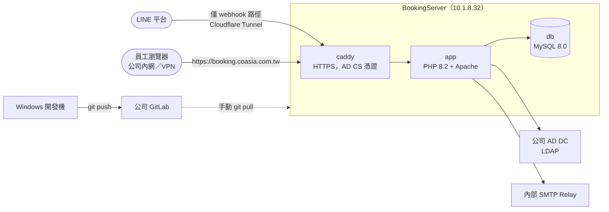

# CoAsia Booking

[](https://www.php.net/)
[](https://www.mysql.com/)
[](docker-compose.dev.yml)
[](LICENSE.md)

CoAsia 內部的會議室／資源預約系統，服務全體員工。基於開源專案 [LibreBooking](https://github.com/LibreBooking/librebooking) 客製化而成，把它從一套通用的資源排程工具，改造成整合公司既有系統（AD 網域、LINE 官方帳號、內部 SMTP、AD CS 憑證）的內部服務。

**現況：`https://booking.coasia.com.tw` 已在公司內網正式運作**（僅限內網／VPN，不對外公開），AD 帳密登入、HTTPS（公司 AD CS 簽發、所有網域電腦自動信任）都已生效。開放給全體員工前還有少數收尾事項，見 [COASIA-GOLIVE-CHECKLIST.md](COASIA-GOLIVE-CHECKLIST.md)。

- 程式碼保存於公司 GitLab（`coasiait/coasia-booking`）
- 正式環境：`BookingServer`（`10.1.8.32`，Ubuntu 26.04 LTS，ESXi VM），Docker Compose 跑三個服務（`app`／`db`／`caddy`）
- 上游原始專案：[LibreBooking/librebooking](https://github.com/LibreBooking/librebooking)（追蹤 `develop` branch，未來可 `git fetch upstream` 合併官方更新）

---

## 目錄

- [這個 fork 做了什麼客製化](#這個-fork-做了什麼客製化)
- [技術棧](#技術棧)
- [架構](#架構)
- [開發環境](#開發環境)
- [正式環境](#正式環境)
- [文件索引](#文件索引)
- [授權與致謝](#授權與致謝)

---

## 這個 fork 做了什麼客製化

跟原版 LibreBooking 相比，主要差異分成幾類，完整異動記錄與每項改動的原因見 [COASIA-CHANGES.md](COASIA-CHANGES.md)（目前已寫到 §78）：

### 身份驗證與帳號

- **Active Directory 網域登入**：員工用既有的 AD 帳密登入，首次登入自動建立帳號（預設一般員工權限，不是管理員），既有管理員身份完整保留；姓名/Email/部門隨每次登入從 AD 同步；離職/復職後再登入會自動恢復原帳號，不會產生重複帳號；LDAP 服務帳號目前走明文 389（暫時方案，見 `COASIA-GOLIVE-CHECKLIST.md`）
- **AD 故障時不留全域後門**：本機密碼登入只保留給後台個別勾選「本機專屬登入」的少數緊急管理員帳號，其餘帳號在 AD 連不上或被拒絕時一律直接擋下，不會有任何帳號能繞過
- **AD 帳號狀態定期回收**：新增 `Jobs/ad-reconcile-account-status.php`，定期反查 AD 帳號是否已停權/鎖定/被刪除，自動停用對應的 LibreBooking 帳號並撤銷該使用者已開啟的瀏覽器 Session（`--dry-run`/`--apply` 二選一，尚未排入 VM 排程，見 `COASIA-CHANGES.md` §81）
- **員工帳號批次匯入**：串接 HR/AD 匯出的名單批次建立帳號，讓從未登入過的員工也能立即被「新增參與者」搜尋到，AD 登入時會自動接上這筆預建帳號，不會產生重複帳號
- **資源權限模型**：全體員工預設開放所有資源，部門/資源層級可個別限制，修掉了新帳號/AD 帳號的權限漏洞

### 通知系統

- **LINE 官方帳號推播**：預約建立、提醒等通知透過 LINE 推播，取代/補充 email；修過綁定卡住、同支手機重複綁定產生殭屍帳號等 bug
- **Email 通知重新設計**：確認信、提醒信版面重新設計，含視訊會議主持人資訊整合、ICS 附件修正一批真實 RFC 5545 錯誤
- **SMTP 改接公司內部郵件伺服器**：取代原本掛在個人信箱底下的 Gmail relay

### 視訊會議整合

- **視訊會議資訊自動帶入**：預約 Zoom TW/CN/Oversea、Google Meet 等視訊資源時，確認頁、確認信、提醒信自動帶出該資源的連結、會議 ID、密碼；判斷依據是資源的 `video_url` 自訂屬性是否有值，實體會議室完全不受影響、不顯示任何視訊區塊
- **會議室管理依資源類型簡化**：新增 ResourceType（實體會議室／線上會議），管理後台的資源編輯抽屜依類型只顯示相關欄位——實體會議室只留名稱＋狀態，線上會議改顯示連結／會議ID／密碼＋主持人登入帳密（新增的 admin 編輯介面，帳密沿用既有的加密儲存機制）

### 預約引擎與資料安全

- **併發安全**：resource lock + optimistic version locking + idempotency，處理多人同時搶同一個時段的競爭條件；[COASIA-TEST-REPORT.md](COASIA-TEST-REPORT.md) 用真實雙 MySQL 連線的併發測試框架驗證過 9 個情境全數通過
- **政策變更**：所有預約禁止跨日
- **時段判斷修正**：修正「此時段可用」誤判前一場會議剛結束時段為衝突的 bug
- **編輯預約時間錯誤修正**：修正編輯既有預約時，表單時間被時間表區段的起訖時間覆蓋（誤把「開放時間起點」當成預約開始時間）的 bug——只改標題按更新，原本的時間也會被改掉
- **Quick Create 補上重複送出保護**：原本只有完整表單有帶 idempotency 用的 requestId，Quick Create 從來沒真正生效過，網路逾時重送理論上可能建出重複預約，已補齊
- **修正跨日驗證對不存在時間表時直接 500**：資源指向的時間表被刪除／不存在時，改成退回系統預設時區繼續驗證，不會讓整個預約請求崩潰
- **行事曆自動更新**：分頁前景時每 30 秒自動刷新事件，回到分頁時立即刷新一次，不用再手動整理頁面才看得到別人剛建立的預約

### UI／UX

- **整套介面重建為 Google Calendar／Material 3 風格**：取代原版介面，包含週檢視、月曆、事件卡片
- **Quick Create 快速建立彈窗**：取代舊版跳轉表單，Grid 版面、單一資源選擇器、真實可用性查詢，經過多輪細節打磨
- **統一日期時間選擇器**：Quick Create 跟「更多選項」完整表單共用同一套邏輯
- **參與者/外部訪客邀請**：Drawer 內建參與者搜尋＋chip，支援內部同事與外部訪客，含 ICS 行事曆邀請
- **管理後台整體重整**：資訊架構、共用版型、管理總覽儀表板、會議室使用分析，預約/會議室/開放時間管理三頁重新設計
- **CoAsia 品牌視覺**：CoAsia Blue 主色、統一 Design Token 系統、全站字體統一為 Noto Sans TC、登入頁重新設計
- **側邊欄多輪重構**：收合/展開、圖示排版系統化、新增預約與通知設定移出主導覽
- **「我的帳號」重新設計**：Profile 頁面改成跟通知設定一致的卡片風格，時區、登入後語言切換（英/繁中/簡中）都在同一頁完成，側邊欄簡化成單一直接連結
- **側邊欄「新增預約」統一走快速預約**：非行事曆頁面點擊時改成導到行事曆頁面自動開快速預約（時間預設值同步改成跟快速預約一致的「進位到下一個半點」），取代原本會退回舊版完整表單、時間直接用「現在」的行為
- **新增「我的會議」頁面**：側邊欄新導覽連結，內容含「下一場會議」卡片（倒數、查看詳情、線上會議一鍵加入）與既有的完整預約清單
- **新增首次登入導覽與使用手冊**：登入後第一次進行事曆頁自動跳出 7 步驟導覽（側邊欄逐項介紹、選會議室、查看空檔、拖曳建立、編輯/取消、我的會議），之後可從側邊欄「幫助」→「操作教學」重播；同一個選單另有「使用手冊」連結到新的完整說明頁，內容依 `$CanViewAdmin` 分成一般使用者／管理員兩區塊，中英文皆有
- **簡化語言與時區選單**：語言只保留繁中／簡中／英文三種（`enabled.languages` 設定），既有帳號設成其他語言會自動安全回退英文；時區從近 400 個 IANA 城市名稱簡化成約 32 個「(GMT+08:00) 北京、新加坡、台北」這種代表選項（多城市標籤、三語言翻譯），GMT 偏移量即時計算、正確反映夏令時間，底層仍儲存合法 IANA timezone，個人帳號頁／註冊頁／管理員新增與編輯使用者頁四處統一套用
- **週／日行事曆色塊加上預約者名字**：標題、時間之下再加一行預約者的名（僅 firstName，粗體），跟隱私規則走同一條路，看不到預約詳情的使用者也看不到這個名字
- **行事曆空白區塊加上 hover 預覽**：週/日/月三種檢視滑鼠移過空白區塊會有淡淡的底色回饋，讓使用者知道這裡可以點/拖曳建立預約，之前完全沒有任何視覺提示
- **會議室選單改成依地區分組的兩層 Accordion**：台北／深圳／上海三個辦公室的實體會議室＋線上會議室（跨地區）各自成一組，預設全部收合、同一時間只能展開一組，打開選單會自動展開目前選取項目所在的那組；觸發按鈕與清單項目改成「地區 · 會議室」配對顯示（例如「台北 · 台北 Taipei」），同地區的會議室統一使用固定主色（台北藍／深圳紫／上海橘／線上青綠，取代原本每間各自一色的雜亂配色），選單圓點、清單勾選背景與行事曆事件顏色三處保持一致；點選會議室不會自動收合選單，可以緊接著在同一個選單裡按下方的「設為預設會議室」按鈕；重新定義「預設會議室」判斷順序（使用者自訂預設→上次選擇→舊版個人設定→都沒有則預設選擇「台北 · 台北 Taipei」），設定成功會即時顯示「✓ 目前預設會議室」與成功提示

### 資料完整性／管理後台修正

- 修正新帳號語言預設值 bug（新建帳號會被寫死成英文，蓋掉瀏覽器語言判斷）、修正三個資源的開放時間資料錯誤（起訖時間相同，等於完全沒開放）
- 預約管理列表預設排序改成最新在前；修掉一個把開放時間編輯的儲存按鈕整個蓋住的浮動按鈕重疊問題
- **「系統設定」重做成「系統診斷」狀態儀表板**：AD／SMTP／LINE／檔案權限四項即時健康檢查（正常/異常/尚未設定＋處理建議），取代原本只有伺服器時間/目錄路徑/外掛清單的除錯資訊；新增系統架構圖、維運文件兩個文件頁面
- 修正使用分析頁「匯出 Excel」功能（closure 忘記帶入外層變數，點擊直接噴錯）
- 修正使用者管理「最後登入」時間顯示錯誤：預設時區從 LibreBooking 上游沿用的 `Europe/London` 改成 `Asia/Taipei`，列表改讀目前登入管理員自己的 session 時區而非系統設定值
- 修正開放時間管理「開啟」某天並儲存會靜默失敗的 bug（缺少自動補齊前後空隙的 blocked 時段，導致後端「必須覆蓋整天」的驗證沒過，且錯誤訊息寫進畫面不會顯示的節點）——「關閉」某天則不受影響
- **管理中心新增「地區」分類**：沿用 LibreBooking 上游原生但這個部署一直沒用到的 `resources.location` 欄位，回填台北／深圳／上海／跨地區四個固定值；會議室管理、預約管理、開放時間、管理總覽、使用分析、CSV 匯入匯出都支援依地區篩選/分組/統計，全站相關清單與下拉選單排序統一改成地區優先（同地區的會議室排在一起），取代原本容易讓同名但不同辦公室的會議室交錯出現的純字母排序

---

## 技術棧

| 分類 | 技術 |
| --- | --- |
| 後端 | PHP 8.2+、Apache |
| 資料庫 | MySQL 8.0 |
| 樣板/前端 | Smarty、Bootstrap 5、FullCalendar |
| 容器化 | Docker、Docker Compose（開發與正式環境分別用 `Dockerfile.dev`/`Dockerfile.prod`） |
| 反向代理／TLS | Caddy 2 |
| 身份驗證 | Active Directory（LDAP） |
| 通知 | LINE Messaging API、SMTP |
| 版本控制 | Git，公司 GitLab |
| CI（現行） | GitHub Actions（`.github/workflows`）：lint、phpstan、phpunit |

---

## 架構



主體服務內網限定，唯一對外公開的是 LINE Webhook 這一條路徑（範圍限定的 Cloudflare Tunnel，其他路徑一律 404），細節見 `COASIA-DEPLOYMENT.md` 十四。

上面這張圖是**部署層**（VM、容器、網路）的架構。**程式碼層**（前端／後端／資料庫怎麼組織、request 怎麼流過系統）見 [COASIA-ARCHITECTURE.md](COASIA-ARCHITECTURE.md)；正式環境更詳細的部署架構圖（含 volumes、機密檔案管理）在 [COASIA-DEPLOYMENT.md](COASIA-DEPLOYMENT.md)。

---

## 開發環境

```bash
docker compose -f docker-compose.dev.yml up -d
```

啟動後：
- App：`http://localhost:8080`
- Mailpit（假 SMTP，攔截開發時寄出的信）：`http://localhost:8025`
- MySQL：對外開在 `3307`（方便用 GUI 工具直連）

詳細設定見 [Dockerfile.dev](Dockerfile.dev) / [docker-compose.dev.yml](docker-compose.dev.yml)。開發環境的 opcache 關掉了 timestamp 檢查換效能（bind mount 下這個很重要），改完 PHP 程式碼如果沒生效，跑 `docker compose -f docker-compose.dev.yml restart app`。

首次啟動前，把 `config/config.dist.php` 複製成 `config/config.php` 並填入本機設定（這個檔案不進版控）。從零開始（全新電腦、資料庫也要建）的完整步驟見 **[COASIA-DEV-SETUP.md](COASIA-DEV-SETUP.md)**。

常用指令：

```bash
composer install                       # PHP 依賴
composer preflight                     # 檢查環境（PHP 版本、擴充套件、config.php、資料庫連線）
composer phpunit                       # 跑單元測試
composer phpstan                       # 靜態分析
npm install && npm run lint:frontend   # 前端 lint（JS/CSS）
```

---

## 正式環境

正式環境用完全獨立的一組容器設定（`Dockerfile.prod` / `docker-compose.prod.yml` / `Caddyfile`），不共用開發環境的設定，程式碼直接 bake 進 image、不用 bind mount。

**現行架構**：
- Linux VM `BookingServer`（`10.1.8.32`，Ubuntu 26.04 LTS）跑在公司 ESXi 上，固定 IP（DHCP 保留）
- 三個 Docker Compose 服務：`caddy`（反向代理／HTTPS）→ `app`（PHP+Apache）→ `db`（MySQL 8.0）
- 內部 DNS：`booking.coasia.com.tw` → `10.1.8.32`（公司自己的 AD DNS，非公開網域）
- HTTPS 憑證由公司 AD CS（`coasia-CSSRV-CA`）簽發，所有網域電腦自動信任，不會跳警告
- **僅限內網／VPN 存取**，沒有對外開放任何 port，攻擊面極小
- 機密設定（資料庫密碼、AD 服務帳號、SMTP）都用 bind mount 從 VM 上的實體檔案掛進容器，不進版控、不進 image

完整的部署架構、每一步操作指令、以及部署過程中踩過的坑（含一個排查很久的環境變數覆蓋 bug），見 **[COASIA-DEPLOYMENT.md](COASIA-DEPLOYMENT.md)**。

---

## 文件索引

| 文件 | 內容 |
| --- | --- |
| [COASIA-DEV-SETUP.md](COASIA-DEV-SETUP.md) | 本機開發環境從 0 到 1 完整搭建指南（全新電腦也適用，不需要任何公司內部密碼） |
| [COASIA-ARCHITECTURE.md](COASIA-ARCHITECTURE.md) | 系統架構參考：前端／後端／資料庫三層各自怎麼組織、request 怎麼流過整個系統、資料庫完整 59 張表清單 |
| [COASIA-CHANGES.md](COASIA-CHANGES.md) | 客製化異動記錄：改了什麼、為什麼這樣改（目前 §1–§78） |
| [COASIA-TEST-REPORT.md](COASIA-TEST-REPORT.md) | 多人使用測試矩陣（併發、隱私、多語言、負載等），逐項結果與修復紀錄 |
| [COASIA-GOLIVE-CHECKLIST.md](COASIA-GOLIVE-CHECKLIST.md) | 正式對全體員工開放前，還缺什麼 |
| [COASIA-DEPLOYMENT.md](COASIA-DEPLOYMENT.md) | 正式環境部署架構與操作手冊，含完整 VM 建置、Docker、憑證、資料庫遷移步驟 |

---

## 授權與致謝

本專案基於 [LibreBooking](https://github.com/LibreBooking/librebooking)（GPL-3.0）修改而成，LibreBooking 本身是 Booked Scheduler 的 fork。原始專案的說明文件、安裝指引、社群資源請參考 [LibreBooking 官方 repo](https://github.com/LibreBooking/librebooking) 與[官方文件](https://librebooking.readthedocs.io/en/latest/)。

License：[GPL-3.0](LICENSE.md)
